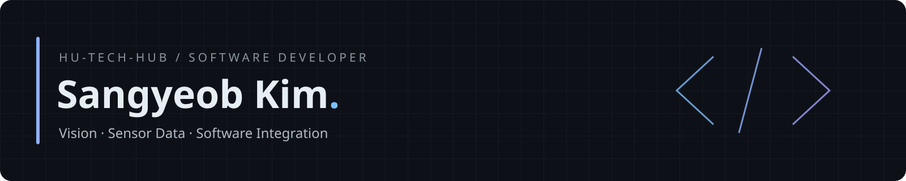
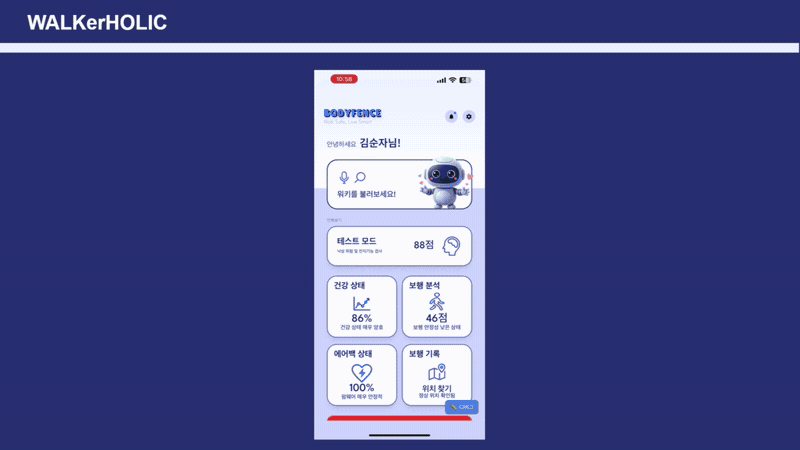
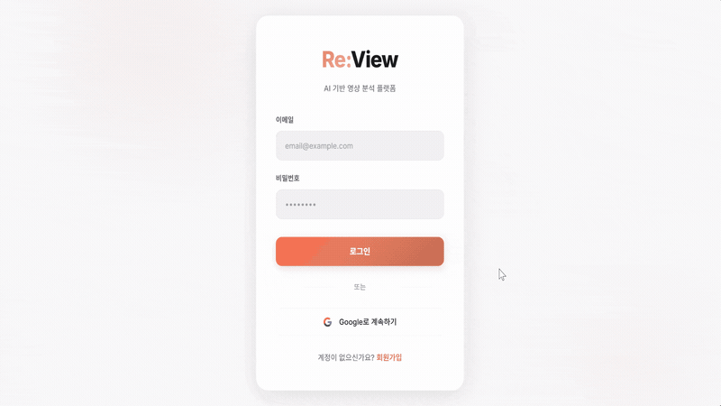
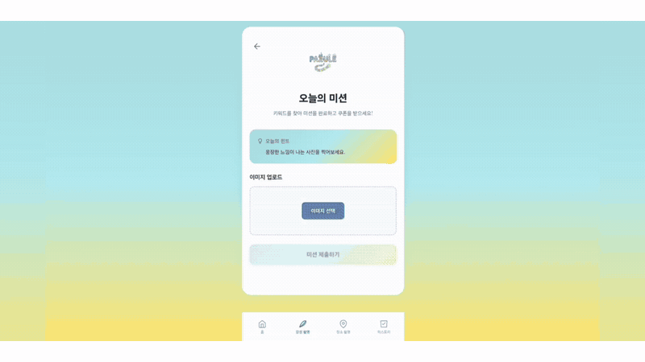
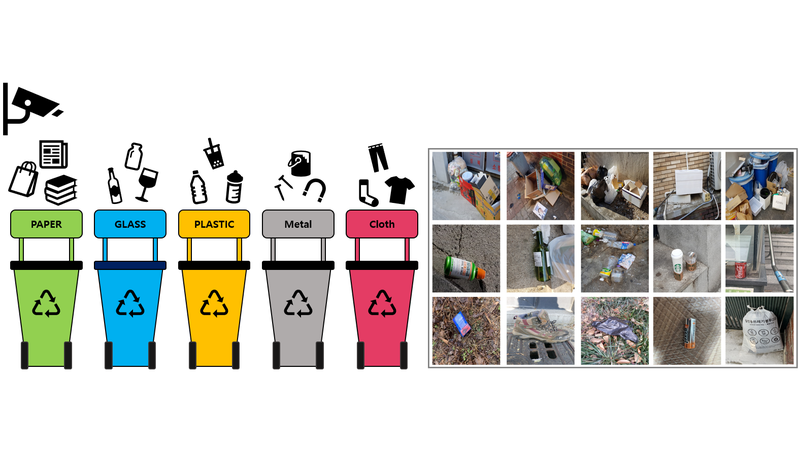
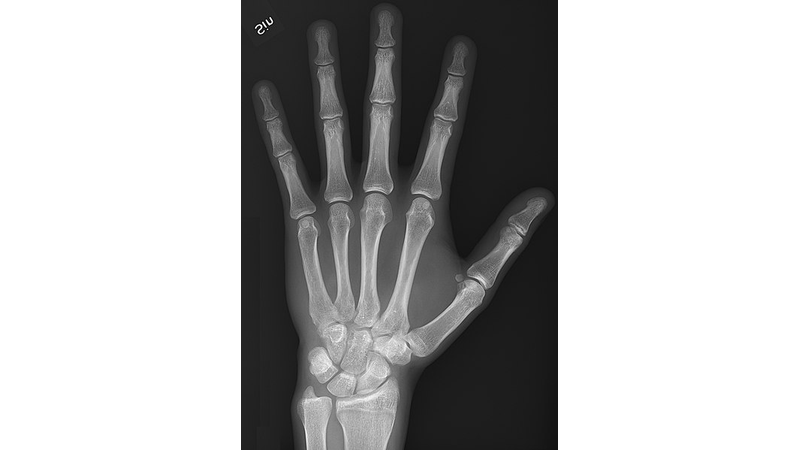

<!-- Layout references:
https://github.com/DenverCoder1/DenverCoder1/blob/HEAD/README.md
https://github.com/alexandresanlim/alexandresanlim/blob/HEAD/README.md
Project grouping and descriptions are specific to Hu-tech-hub. -->

영상과 센서 데이터를 다루고 소프트웨어와 장치를 연결합니다.

 

## 🦿 BODYFENCE
**디지털 스마트 아카데미 부산 · 팀 프로젝트**

보행·분석 결과 하이라이트 · 클릭하면 원본 영상

IMU 센서와 AI를 결합한 보행 분석·낙상 감지 플랫폼

**[대표 저장소 →](https://github.com/Hu-tech-hub/WalkerHolic)**

### 데이터 구축·보행 분석

| 저장소 | 내용 |
| :--- | :--- |
| [make_gait_data](https://github.com/Hu-tech-hub/make_gait_data) | 영상·IMU 데이터 처리와 보행 단계 라벨링 |
| [Stride_Length_Estimation_Model](https://github.com/Hu-tech-hub/Stride_Length_Estimation_Model) | TCN 기반 보폭 추론과 GUI·CLI 실행 |
| [NAKSANG](https://github.com/Hu-tech-hub/NAKSANG) | IMU 기반 보행 이벤트 감지·시각화 |

<strong>🧪 별도 실험 · 센서 분석·챗봇·RAG</strong>

최종 시스템과 구분되는 별도 실험 저장소입니다.

| 저장소 | 실험 내용 |
| :--- | :--- |
| [gait-analyzer-chronos-langchain](https://github.com/Hu-tech-hub/gait-analyzer-chronos-langchain) | Chronos 임베딩 기반 센서 분석 RAG |
| [Chatbot](https://github.com/Hu-tech-hub/Chatbot) | MongoDB 기반 텍스트 처리·챗봇 |
| [rag-system](https://github.com/Hu-tech-hub/rag-system) | 문서 검색·질의응답 파이프라인 |

<strong>📎 참고 모델</strong>

[Chronos](https://github.com/Hu-tech-hub/Chronos) · 시계열 모델 참고 저장소

 

## 🚗 ArUco Autonomous Cart
**캡스톤 디자인 · 팀 프로젝트**

천장의 ChArUco Diamond 마커로 위치와 방향을 추정하고 주행을 제어하는 자율주행 카트

**[저장소 →](https://github.com/Hu-tech-hub/ArUco_Autonomous_Car)**

 

## 🌱 Naver Boostcamp AI Tech
**팀 프로젝트 · Computer Vision**

<table width="100%">
<tr>
<td width="50%" valign="top">
<h3>Re:View</h3>

강의 화면과 음성을 함께 분석하는 AI 강의 노트

<a href="https://github.com/seolbbb/Re-View"><strong>저장소 →</strong></a>

</td>
<td width="50%" valign="top">
<h3>PAZULE</h3>

사진으로 파주 출판단지 명소를 찾는 AI 미션 게임

<a href="https://github.com/seung23/PAZULE"><strong>저장소 →</strong></a>

</td>
</tr>
<tr>
<td width="50%" valign="top">
<h3>Object Detection</h3>

10개 재활용 품목의 종류와 위치를 탐지하는 프로젝트

<a href="https://github.com/boostcampaitech8/pro-cv-objectdetection-cv-02"><strong>저장소 →</strong></a>

</td>
<td width="50%" valign="top">
<h3>Semantic Segmentation</h3>

손 X-ray에서 29개 뼈 영역을 픽셀 단위로 분할하는 프로젝트

<a href="https://github.com/boostcampaitech8/pro-cv-semanticsegmentation-cv-02"><strong>저장소 →</strong></a>

</td>
</tr>
</table>

손 X-ray 예시 이미지 출처: <a href="https://en.m.wikipedia.org/wiki/File:X-ray_of_normal_hand_by_dorsoplantar_projection.jpg">Wikipedia</a>

 

## ⚙️ PLC Virtual Factory
**개인 프로젝트 · 가상 검사 자동화**

PLC 시퀀스와 GOT 화면 및 Unity 가상설비를 연결한 검사 자동화 시뮬레이션

**[저장소 →](https://github.com/Hu-tech-hub/PLC_VirtualFactory)**

 

## 🔬 Computer Vision Lab
**영상처리 연구실 · 학습·랩미팅 기록**

영상 필터링·SIFT/ORB 특징점·카메라 캘리브레이션·수학 기초 학습 자료

**[저장소 →](https://github.com/Hu-tech-hub/Computer_Vision_Lab)**

 

## 🛠️ Tech Stack

**Languages**

**Vision & AI**

**Backend · Device · Tools**

