<!-- Layout adapted from anuraghazra/anuraghazra and DenverCoder1/DenverCoder1.
     Local SVG repository cards avoid relying on a third-party statistics server. -->

영상과 센서 데이터를 다루고 소프트웨어와 장치를 연결합니다.

<h2>🦿 디지털 스마트 아카데미 부산 · BODYFENCE</h2>

<a href="https://github.com/Hu-tech-hub/WalkerHolic">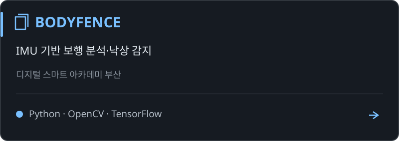</a>

IMU 센서와 AI를 결합한 보행 분석·낙상 감지 프로젝트입니다. 아래에 관련 데이터 처리·추론·보행 이벤트·RAG 실험 및 시연 저장소를 모았습니다.

BODYFENCE · 시연

[BODYFENCE GIF]

BODYFENCE · 관련 모듈과 실험 저장소 펼치기

<a href="https://github.com/Hu-tech-hub/make_gait_data">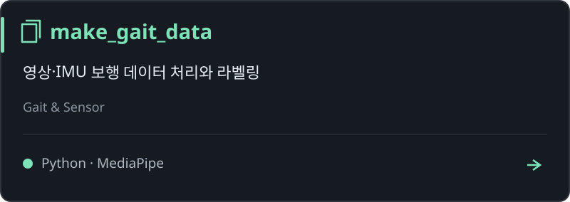</a>
<a href="https://github.com/Hu-tech-hub/Stride_Length_Estimation_Model">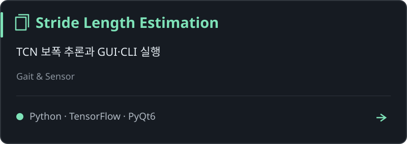</a>
<a href="https://github.com/Hu-tech-hub/NAKSANG">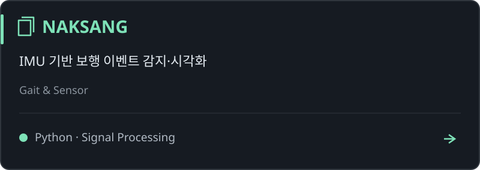</a>
<a href="https://github.com/Hu-tech-hub/gait-analyzer-chronos-langchain">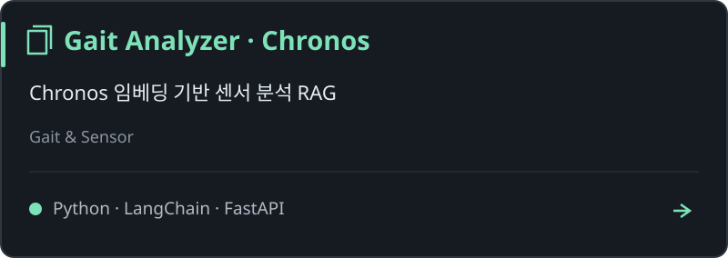</a>
<a href="https://github.com/Hu-tech-hub/Chatbot">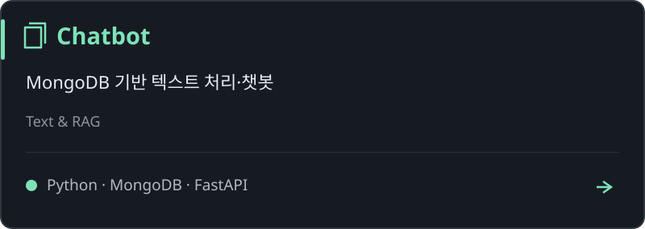</a>
<a href="https://github.com/Hu-tech-hub/rag-system">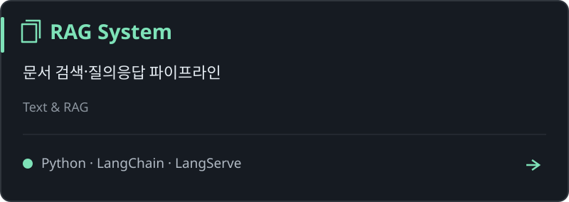</a>
<a href="https://github.com/Hu-tech-hub/WALKerHOLIC_Video">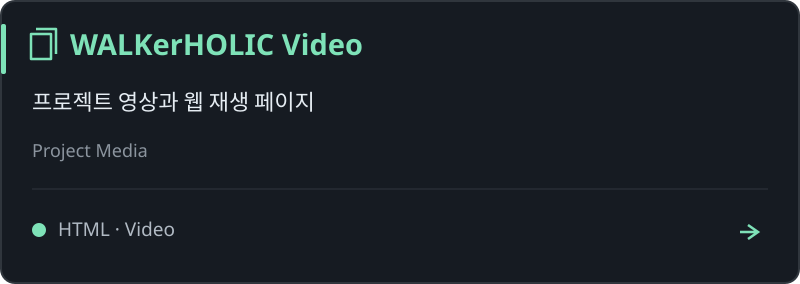</a>

**시계열 모델 참고:** [Chronos](https://github.com/Hu-tech-hub/Chronos)

<h2>🚗 캡스톤 디자인 · 자율주행 카트</h2>

<a href="https://github.com/Hu-tech-hub/ArUco_Autonomous_Car">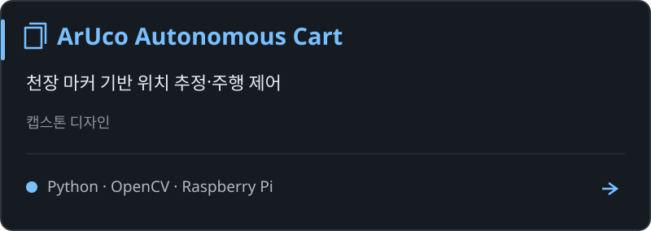</a>

천장의 ChArUco Diamond 마커를 인식해 위치와 방향을 추정하고 주행을 제어한 캡스톤 디자인 프로젝트입니다.

ArUco Autonomous Cart · 시연

[ArUco Autonomous Cart GIF]

<h2>🌱 네이버 부스트캠프 AI Tech</h2>

<a href="https://github.com/seolbbb/Re-View">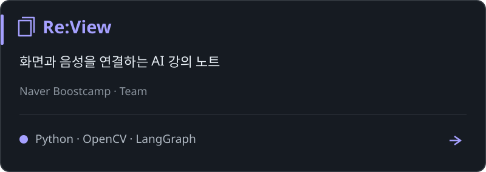</a>
<a href="https://github.com/seung23/PAZULE">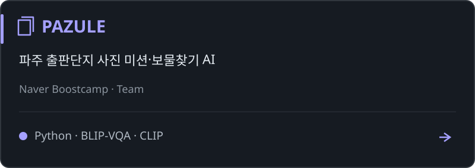</a>
<a href="https://github.com/boostcampaitech8/pro-cv-objectdetection-cv-02">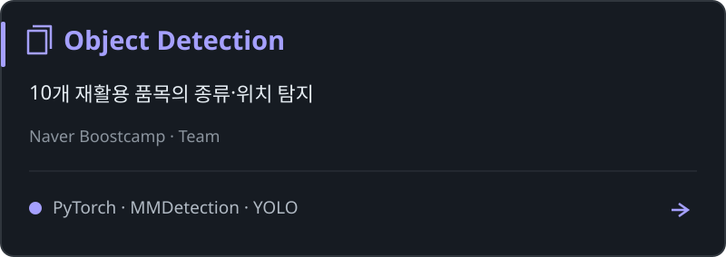</a>
<a href="https://github.com/boostcampaitech8/pro-cv-semanticsegmentation-cv-02">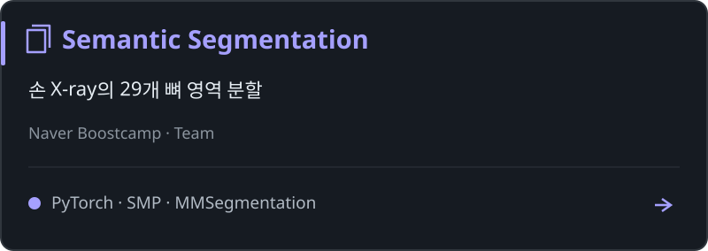</a>

**Object Detection 개인 계정 저장소:** [pro-cv-objectdetection-cv-02](https://github.com/Hu-tech-hub/pro-cv-objectdetection-cv-02)

부스트캠프 프로젝트 시연

### Re:View

[Re:View GIF]

### PAZULE

[PAZULE GIF]

### Object Detection

[Object Detection GIF]

### Semantic Segmentation

[Semantic Segmentation GIF]

<h2>⚙️ 개인 프로젝트 · PLC Virtual Factory</h2>

<a href="https://github.com/Hu-tech-hub/PLC_VirtualFactory">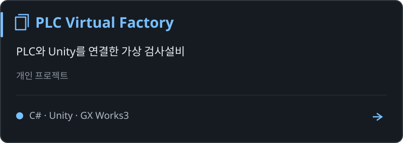</a>

PLC 시퀀스와 GOT 화면 및 Unity 가상설비를 연결한 개인 프로젝트입니다.

PLC Virtual Factory · 시연

[PLC Virtual Factory GIF]

<h2>🔬 영상처리 연구실</h2>

<a href="https://github.com/Hu-tech-hub/Computer_Vision_Lab">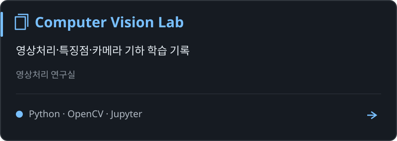</a>

영상처리 기초·SIFT/ORB 특징점·카메라 캘리브레이션·수학 기초를 학습하고 정리한 랩미팅 자료입니다.

Computer Vision Lab · 시연

[Computer Vision Lab GIF]

<h2>🧪 그 외 프로젝트와 실험</h2>

<a href="https://github.com/Hu-tech-hub/detect_object_rc">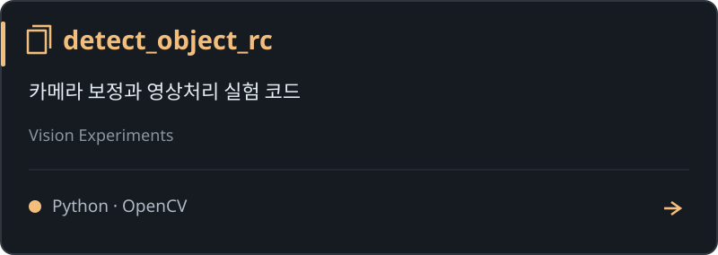</a>
<a href="https://github.com/Hu-tech-hub/BlindAssist-Wearable">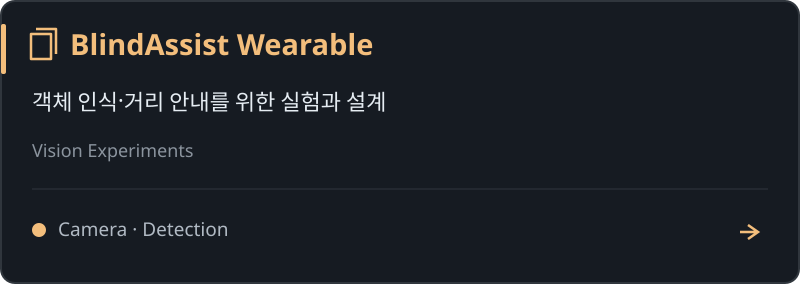</a>
<a href="https://github.com/Hu-tech-hub/Dive_Bada">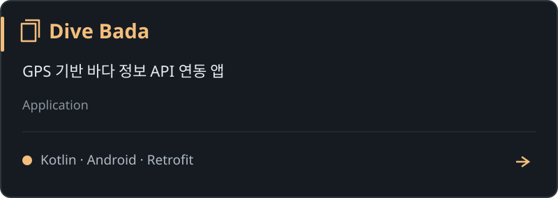</a>

<h2>📚 학습·교재·연습 저장소</h2>

<a href="https://github.com/Hu-tech-hub/jump2python">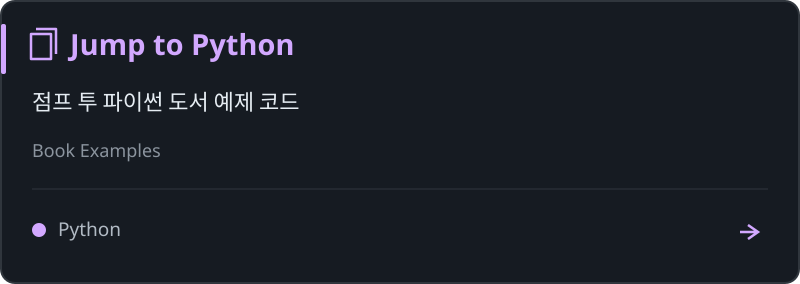</a>
<a href="https://github.com/Hu-tech-hub/Coding_Test_Python">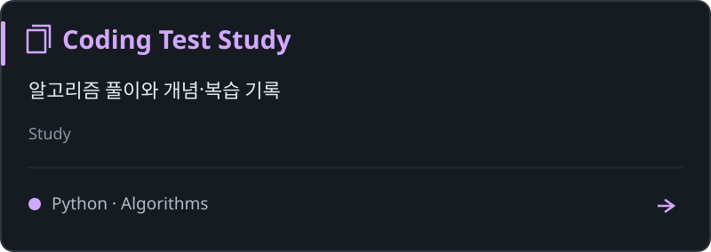</a>
<a href="https://github.com/Hu-tech-hub/codingtest_python">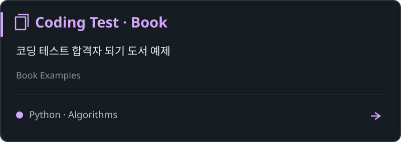</a>
<a href="https://github.com/Hu-tech-hub/aifoodnlife">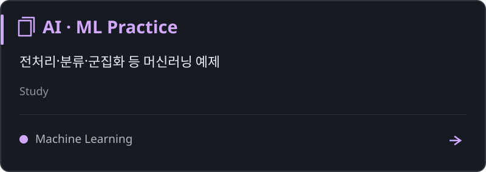</a>
<a href="https://github.com/Hu-tech-hub/pymlrev2">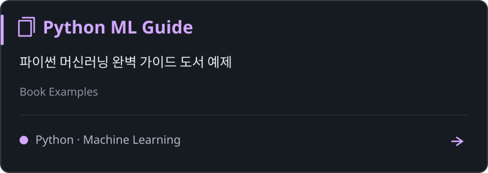</a>
<a href="https://github.com/Hu-tech-hub/Fast_API">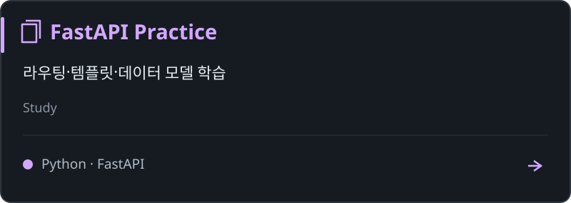</a>
<a href="https://github.com/Hu-tech-hub/Pytorch">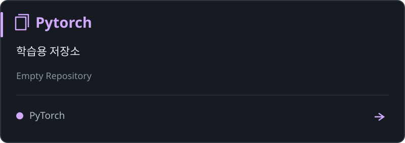</a>
<a href="https://github.com/Hu-tech-hub/google_adk_practice">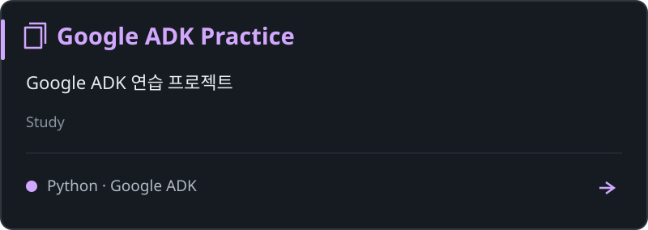</a>
<a href="https://github.com/Hu-tech-hub/github-practice">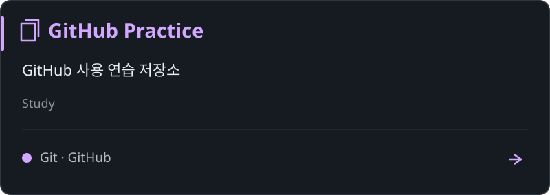</a>

<h2>🌐 포트폴리오 웹사이트·프로필</h2>

<a href="https://github.com/Hu-tech-hub/Hu-tech-hub.github.io">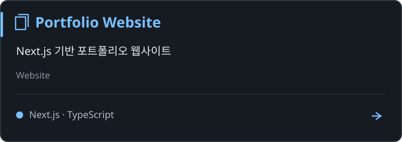</a>
<a href="https://github.com/Hu-tech-hub/Hu-tech-hub">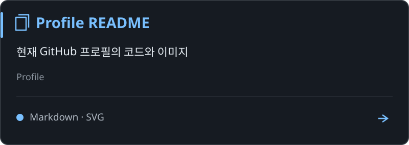</a>

<h2>🛠️ Languages & Tools</h2>

**Languages**

**Vision & AI**

**Backend · Device · Tools**

